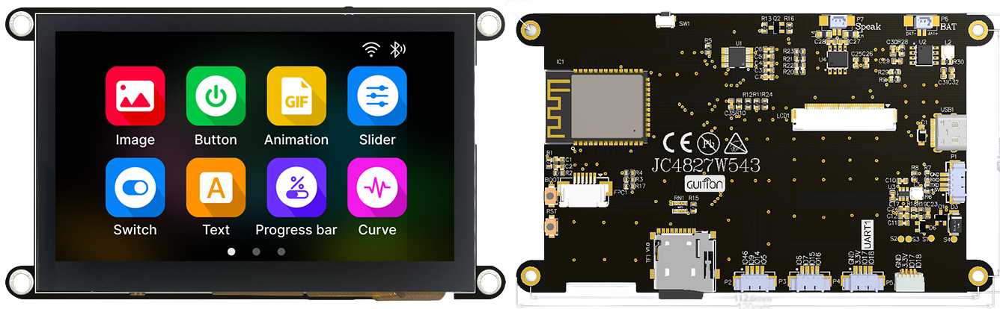
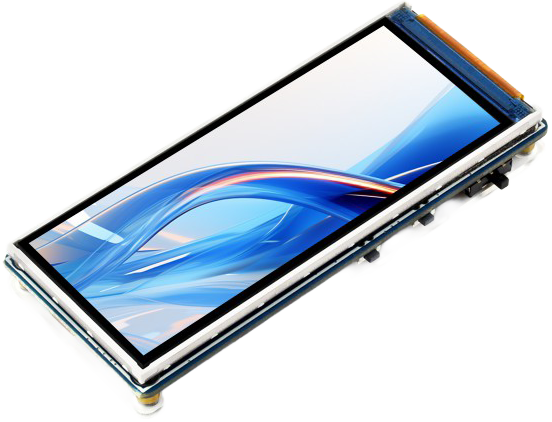
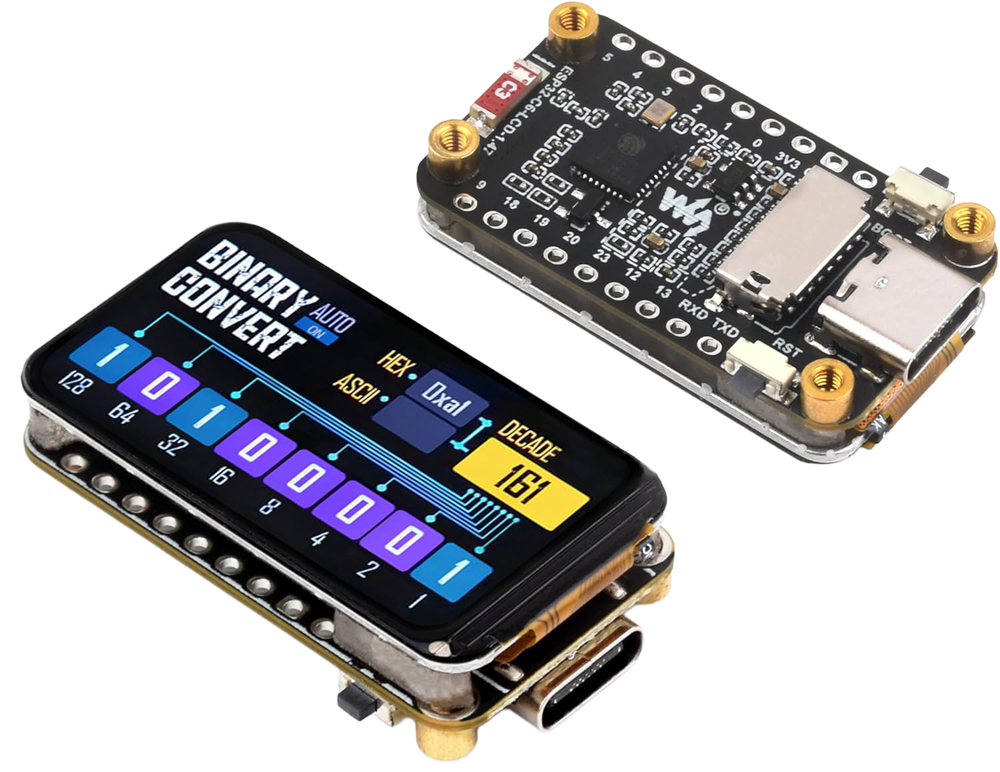
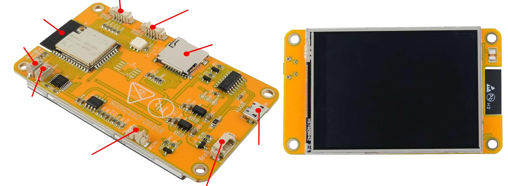
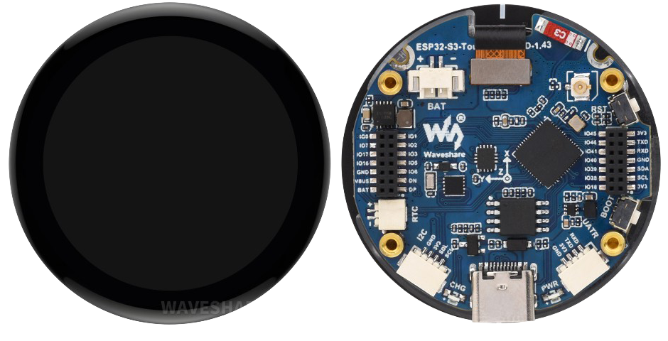

# ESPImageServer

ESPImageServer is a free app that creates images and videos using AI models running locally on your own computer. Describe what you want to create, then save it to your Creation Library or send it to a supported ESP32 display over your local network.

**No API registration, API key, subscription, or per-generation fee is required.** Image and video generation runs on your NVIDIA GPU, not a paid cloud service. Internet access is needed to download the app, dependencies, and AI models; your prompts and generated images and videos stay on your computer.

Turn a supported ESP32 board into a small digital art display: show images, play videos, and save your favorites to its SD card over Wi-Fi. Configure a **Display Experience** to keep playing saved images and videos when the server is unavailable.

## Download and install

**[Download installers from the latest release](https://github.com/thelastoutpostworkshop/ESPImageServer/releases/latest)**

Choose the installer for your computer from the release's **Assets** list. Installation and update instructions are included in the release notes:

| Platform | Installer | Generation setup |
| --- | --- | --- |
| Windows x64 | `ESPImageServer-Setup-<version>.exe` | Downloads dependencies during installation |
| Ubuntu 24.04 x64 | `ESPImageServer-<version>-linux-x64.deb` | Downloads dependencies automatically on first launch |

Both platforms require a supported NVIDIA GPU with CUDA for image and video generation. macOS installers are not included in the current release.

## Supported boards

Check the model and variant when ordering. Some purchase links are affiliate links.

| Board | Model | Resolution | Touch supported by firmware | Buy |
| --- | --- | --- | --- | --- |
|  | **JC4827W543** 4.3-inch IPS | 480 x 272 | Yes - choose the capacitive GT911 variant | [AliExpress](https://s.click.aliexpress.com/e/_oEHbBud) |
|  | **Waveshare ESP32-S3 LCD 3.16** 3.16-inch LCD, ST7701 | 320 x 820 | No | [Amazon](https://amzn.to/4689Mbm) [AliExpress](https://s.click.aliexpress.com/e/_c4S9IVQB) |
|  | **Waveshare ESP32-C6 LCD 1.47** 1.47-inch LCD | 172 x 320 | No | [Amazon](https://amzn.to/3ZzfcZr) [AliExpress](https://s.click.aliexpress.com/e/_okJAvee) |
|  | **Cheap Yellow Display ESP32-2432S028R** 2.8-inch LCD, ILI9341 | 240 x 320 | No | [Amazon](https://amzn.to/4kAyDJh) [AliExpress](https://s.click.aliexpress.com/e/_oCVWMbC) |
|  | **Waveshare ESP32-S3 Touch AMOLED 1.43** 1.43-inch round AMOLED | 466 x 466 | Yes - FT3168 | [Amazon](https://amzn.to/41VszVi) [AliExpress](https://s.click.aliexpress.com/e/_ondyHh3) |

Install compatible firmware through **Set up display** in the desktop app.

## What you need

- A Windows x64 or Ubuntu 24.04 x64 computer.
- For displaying your creations: a supported ESP32 board running compatible firmware, connected to the same local network. You can generate images and videos without a connected display.
- Enough free disk space for AI models. The first use of a model downloads its files.

Image and video generation require a working NVIDIA graphics card with CUDA.
Without CUDA, the app supports display management and saved creations; CPU
generation is disabled.

See [release installation instructions](https://github.com/thelastoutpostworkshop/ESPImageServer/releases/latest) for platform details. The app is free to use; you supply the computer, display hardware, storage, and electricity.

## Supported generation models

All models run locally and require a supported NVIDIA GPU with CUDA. Model files download on first use and are kept for reuse.

### Image generation

| Model | Description |
| --- | --- |
| DreamShaper 8 | Creative illustrations, fantasy scenes, and stylized artwork. The default image model. |
| Segmind SSD-1B | A compact SDXL-based model for detailed images. |
| SDXL Base 1.0 | Detailed images and rich compositions, with higher GPU memory requirements. |

All three image models support negative prompts to describe what the image should avoid.

### Video generation

| Model | Description | Input |
| --- | --- | --- |
| LTX-Video 2B distilled | Fast short animations, using 4-8 generation steps. | Text, or text with a saved image as the first frame |
| LTX-Video 2B quality | More detail and prompt accuracy, with slower generation using 10-40 steps. | Text, or text with a saved image as the first frame |
| Wan 2.1 T2V 1.3B | A slower text-to-video alternative, using 20-50 steps. | Text only |

Image and video generation share the GPU and run one job at a time. Generated media is resized to the selected display's dimensions.

## Troubleshooting

### Generation is slow

CPU generation is not supported. Generation requires a working NVIDIA GPU with CUDA; computers without one can still manage displays, saved creations, and SD cards.

### A model appears to be stuck loading

The first download can take time, depending on the model size and internet connection. Keep the app open until it finishes. If a previously downloaded model is loading, it may take a moment to move the model into memory.

### The display orientation is wrong

Change **Image rotation** in the Generate page, then create a new image. Rotation applies to newly generated images.

### I cannot find my images

Open **Settings** and select **Open image library folder**. You can also use **Choose image library** to move future images to an empty folder.

## Privacy and network use

Image generation runs locally. Model downloads require internet access the first time a model is installed. After that, normal image generation and ESP32 image delivery use your computer and local network.

For developer setup, testing, and release instructions, see [CONTRIBUTING.md](CONTRIBUTING.md).
