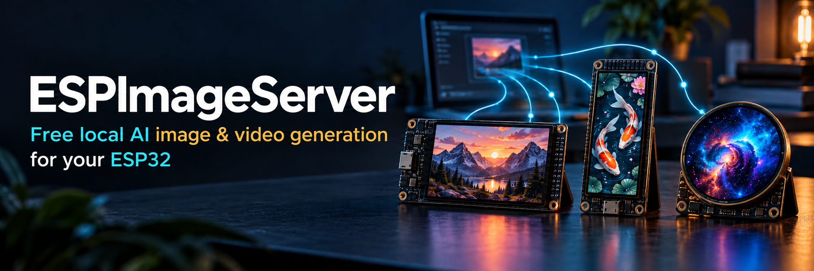

# ESPImageServer

ESPImageServer is a free app that creates images and videos using AI models running locally on your own computer. Describe what you want to create, then save it to your Creation Library or send it to a supported ESP32 display over your local network.

**No API registration, API key, subscription, or per-generation fee is required.** Image and video generation runs on your NVIDIA GPU, not a paid cloud service. Internet access is needed to download the app, dependencies, and AI models; your prompts and generated images and videos stay on your computer.

Turn a supported ESP32 board into a small digital art display: show images, play videos, and save your favorites to its SD card over Wi-Fi. Configure a **Display Experience** to keep playing saved images and videos when the server is unavailable.

[See the Tutorial](https://youtu.be/4_eT38NmxBw)

## Download and install

**[Download installers from the latest release](https://github.com/thelastoutpostworkshop/ESPImageServer/releases/latest)**

Choose the installer for your computer from the release's **Assets** list. Installation and update instructions are included in the release notes:

| Platform | Installer | Generation setup |
| --- | --- | --- |
| Windows x64 | `ESPImageServer-Setup-<version>.exe` | Includes private Python; downloads generation dependencies during installation |
| Ubuntu 24.04 x64 | `ESPImageServer-<version>-linux-x64.deb` | Downloads dependencies automatically on first launch |

Both platforms require a supported NVIDIA GPU with CUDA for image and video generation. macOS installers are not included in the current release.

Windows installation is for your current account and requires Windows 10 22H2 or Windows 11 22H2 or newer. Python and the basic server packages are included; you do not need to install Python or WinGet. Setup prepares and checks a replacement runtime before activating it, and preserves your settings, model cache, and creations during an update or repair.

On Windows, setup checks the Microsoft Visual C++ x64 runtime before installing the app. It downloads the current Microsoft package, verifies its signature, and installs or repairs it when needed. Windows may request administrator approval for this prerequisite. If a restart is required, restart Windows and run the ESPImageServer installer again. Runtime setup logs are kept in `%LOCALAPPDATA%\ESPImageServer\setup-logs`.

The app checks for newer public GitHub releases at most once every 24 hours, including across restarts and failed attempts. An update notice links to the matching installer and release notes; close the app when you are ready to install the update. Use **About > Check for updates** for a manual check, which uses the cached result within the same 24-hour period, or turn off **Automatically check for app updates** in **Settings**; changes save automatically. Drafts and prereleases are ignored. While the repository is private or GitHub is unavailable, automatic checks stay quiet; the same feature starts notifying once a newer release with its installer and checksum is published publicly. Checks use public release metadata without a GitHub token.

## Supported boards

Check the model and variant when ordering. Some purchase links are affiliate links.

| Board | Model | Resolution | Touch supported by firmware | Buy |
| --- | --- | --- | --- | --- |
|  | **JC4827W543** 4.3-inch IPS | 480 x 272 | Yes - choose the capacitive GT911 variant | [AliExpress](https://s.click.aliexpress.com/e/_oEHbBud) |
|  | **Waveshare ESP32-S3 LCD 3.16** 3.16-inch LCD, ST7701 | 320 x 820 | No | [Amazon](https://amzn.to/4689Mbm) [AliExpress](https://s.click.aliexpress.com/e/_c4S9IVQB) |
|  | **Waveshare ESP32-C6 LCD 1.47** 1.47-inch LCD | 172 x 320 | No | [Amazon](https://amzn.to/3ZzfcZr) [AliExpress](https://s.click.aliexpress.com/e/_okJAvee) |
|  | **Cheap Yellow Display ESP32-2432S028R** 2.8-inch LCD, ILI9341 | 240 x 320 | No | [Amazon](https://amzn.to/4kAyDJh) [AliExpress](https://s.click.aliexpress.com/e/_oCVWMbC) |
|  | **Waveshare ESP32-S3 Touch AMOLED 1.43** 1.43-inch round AMOLED | 466 x 466 | Yes - FT3168 | [Amazon](https://amzn.to/41VszVi) [AliExpress](https://s.click.aliexpress.com/e/_ondyHh3) |

Install compatible firmware through **Set up display** in the desktop app.

## What you need

- A Windows 10 22H2 / Windows 11 22H2 or newer x64 computer, or Ubuntu 24.04 x64.
- For displaying your creations: a supported ESP32 board running compatible firmware, connected to the same local network. You can generate images and videos without a connected display.
- Enough free disk space for AI models. The first use of a model downloads its files.

Image and video generation require a working NVIDIA graphics card with CUDA.
Without CUDA, the app supports display management and saved creations; CPU
generation is disabled.

See [release installation instructions](https://github.com/thelastoutpostworkshop/ESPImageServer/releases/latest) for platform details. The app is free to use; you supply the computer, display hardware, storage, and electricity.

## Supported generation models

All models run locally and require a supported NVIDIA GPU with CUDA. Model files download on first use and are kept for reuse.

### Image generation

| Model | Description |
| --- | --- |
| DreamShaper 8 | Creative illustrations, fantasy scenes, and stylized artwork. The default image model. |
| Segmind SSD-1B | A compact SDXL-based model for detailed images. |
| SDXL Base 1.0 | Detailed images and rich compositions, with higher GPU memory requirements. |

All three image models support negative prompts to describe what the image should avoid.

### Video generation

| Model | Description | Input |
| --- | --- | --- |
| LTX-Video 2B distilled | Fast short animations, using 4-8 generation steps. | Text, or text with a saved image as the first frame |
| LTX-Video 2B quality | More detail and prompt accuracy, with slower generation using 10-40 steps. | Text, or text with a saved image as the first frame |
| Wan 2.1 T2V 1.3B | A slower text-to-video alternative, using 20-50 steps. | Text only |

Image and video generation share the GPU and run one job at a time. Generated media is resized to the selected display's dimensions.

## Example prompts

Browse [87 image prompts and 45 video prompts](docs/example-prompts.md) from saved creations, grouped by model. Each example includes its prompt, negative prompt, and recorded settings, with instructions for trying it in the app.

## Troubleshooting

Start with the symptom below. **Queue** shows generation progress, **Diagnostics** shows recent errors and console output, and **About** shows your app version and generation hardware.

### Generation is unavailable or CUDA is not detected

Image and video generation require a supported NVIDIA graphics card, a compatible NVIDIA driver, and the app's CUDA generation dependencies. CPU generation is disabled; display setup, saved creations, and SD-card tools remain available.

- **Windows:** Make sure the NVIDIA driver is installed. If the app's generation dependencies are missing or unusable, re-run the ESPImageServer installer with internet access, then restart the app.
- **Ubuntu:** Let first-launch generation setup finish. After resolving an internet or setup error, use **Retry setup**. After resolving a GPU or driver problem, use **Retry GPU check**. **Open display tools** lets you continue without generation when that option is offered.

### Generation is slow

Check **Queue** first: images and videos share the GPU and run one job at a time. A queued job waits for the current one to finish. Switching between image and video generation also loads a different model.

For a quicker image, start with **DreamShaper 8** and fewer generation steps. For video, try **LTX-Video 2B distilled**, a shorter duration, and its recommended steps. Close other applications using the GPU. A small display still requires a larger working image or video before resizing, so a tiny screen does not make every model fast.

### Generation fails with an out-of-memory error

CUDA being available does not guarantee that every model fits in your graphics card's memory. Try DreamShaper 8 for images, or fewer frames and a shorter clip for video. Close other GPU applications before retrying. Reducing generation steps mainly reduces processing time; it is not a reliable fix for insufficient GPU memory.

### A model appears to be stuck loading

The first use downloads model files and can take several minutes. Check **Queue** and **Diagnostics > Console** for the current stage or a download error. Keep the app open, check internet access, and make sure the computer has free disk space. A cached model still takes time to load into memory.

If an error reports incomplete or corrupted model files, wait for generation to stop, open **Models**, remove the affected model, and select it again to download it on its next use. Model removal preserves saved creations. Read any removal note: the two LTX models share some downloaded files.

### A job stays queued or cancellation is taking time

Open **Queue** to see the active job and cancel unwanted jobs. Cancellation may wait for a model-loading or processing operation to finish. Keep the app open until completion or cancellation is confirmed. Quitting the desktop app stops the local server it started and interrupts unfinished generation.

### USB setup cannot find the board

Use **Set up display** in the desktop app; browser and phone access cannot perform USB installation. Try a USB data cable, a different USB port, and **Refresh ports**. Close serial monitors and other programs using the same port, then identify the board again.

Select the firmware package for your exact board model. If flashing succeeds but firmware startup is not confirmed, release **BOOT**, press **RESET/EN** or reconnect the board, then choose **Check display after restart**. A board left in download mode cannot run its normal firmware until it restarts.

For a **Cheap Yellow Display** update, keep its current firmware running while the app checks the board. Once the app shows **Connecting to your display**, if it does not connect automatically, hold **BOOT**, press and release **RESET/EN**, then release **BOOT**. The app keeps the board in download mode between the flash-memory check and the firmware write, so this sequence is needed only once per installation. It restarts the board after verifying the write.

For failed transfers, open **Connection help and recovery** in the setup window and try the slower **USB transfer speed**.

### Wi-Fi setup fails or my network is missing

Choose a **2.4 GHz** network and check **Network name**, **Network security**, and **Wi-Fi password**. You can enter a hidden network manually. Use **Connect and save** or **Retry connection**, and wait for confirmation.

Wi-Fi being connected and saved does not yet confirm that the board can reach ESPImageServer. Continue to the server-connection step and use **Check server again** after resolving a network problem.

### The display is offline or cannot reach the app

Keep ESPImageServer running and the server computer awake. Check the board's power and Wi-Fi connection, and use **Set up display** to configure or change Wi-Fi when needed. The board and server computer must be on the same local network.

Guest-network isolation, a VPN, or a firewall can prevent devices from reaching the server. Allow the app's server connection on your trusted local network; the default port is **TCP 8000**. The default address is `http://espimageserver.local:8000`, which requires local hostname discovery to work. If a custom server address uses a numeric IP, check that it still matches the server computer's network address.

With several boards, check the active-display chooser at the top of the app or use **Displays > Make active**. New display commands and SD-card actions use that selected board. An offline board's SD list and experience settings are its last reported state.

### SD-card files are missing or saving is unavailable

Check that the selected display is online and reports its card as ready. Open **SD Card** and use **Refresh** after the board reconnects. If the card is not detected, power off the board before checking that the card is seated correctly.

Saving a creation to the computer and saving it to the board's SD card are separate actions. Use **Save to SD card** from the creation's controls, or select items in the Creation Library's list view and choose **Save selected to SD card**. Let an active bulk save finish or cancel it before starting another display operation. If cancellation is waiting for an offline board, reconnect that board so it can confirm the cancellation.

### A video will not play from the SD card

Save videos through the app so it prepares the board's MJPEG video at the correct screen dimensions. Copying an MP4 directly onto the card does not convert it to the board's playback format. Media prepared for another board's dimensions may not play correctly.

If the display reports **MJPEG frame is too large**, increase the **Video JPEG quality** value in Settings to produce smaller frames. Keep the original video in **Creation Library**, delete its existing copy from **SD Card**, and wait for deletion confirmation before saving it to the SD card again. Repeated saves normally reuse an existing SD copy, so removing that copy is needed to apply the new quality. If playback still fails, include the firmware version and any serial error in your issue report.

### The offline slideshow or video loop does not start

In **Display Experience**, choose the experience and click **Save** while the board is online. Wait for confirmation that it is saved on the display. **Preview** only tests playback; it does not save these settings.

The board needs configured Wi-Fi and a working SD card containing matching images or videos. It starts the saved experience after losing contact with ESPImageServer and returns to server control when contact is restored. An empty card or an unsaved experience cannot provide offline playback.

Orientation filtering in **Display Experience** is off by default. Enable it and choose **0°**, **90°**, **180°**, or **270°** to play only files saved for that exact rotation. The board preview shows how the sample artwork appears with the active display. The filter applies to both preview and saved offline playback; it selects matching files without rotating their pixels.

Gallery images and videos keep the orientation saved with each creation when you copy them to the SD card, including bulk saves. Choose the corresponding orientation in **Display Experience**, then save your settings or preview playback. The matching count helps you check that the SD card contains suitable media.

### The display orientation is wrong

Choose the intended display, change **Image rotation** on **Generate image** or **Video rotation** on **Generate video**, then add a new job. Each job keeps the orientation selected when it entered the queue. Changing rotation does not alter jobs already queued, existing creations, or files already saved to the SD card.

### I cannot find my saved images or videos

Open **Creation Library**, check its **Model**, **Display**, and **On SD card** filters, and check whether automatic saving is enabled on the relevant generation page. If automatic saving is off, use the result's save control to keep the creation in the library.

In **Settings**, **Open image library folder** opens the library on the server computer. Videos are in its `videos` subfolder. **Choose image library folder** moves the existing library, including saved creations, to an empty destination. From a phone or another browser, use the displayed path on the server computer if folder actions are unavailable.

### A settings change does not seem to apply

Changes on **Settings** save automatically. After typing a library path, press Enter or leave the field to commit it, and check for a save confirmation or error. **JPEG quality** applies to newly generated images. **Video JPEG quality** applies when preparing a video for the display SD card; lower values retain more detail and produce larger files.

**Display Experience** has its own **Save** button because those settings must be sent to the board.

### Still need help?

[Open an issue on GitHub](https://github.com/thelastoutpostworkshop/ESPImageServer/issues/new) if these steps do not help. Include:

- App version from **About**, operating system, and the steps that reproduce the problem.
- What you expected, what happened, and the exact error message or a screenshot.
- For generation: GPU, selected model, and image or video settings.
- For display or SD problems: board model, firmware version, and whether the board is online.

Use **Diagnostics > Report a problem** to describe the problem and copy an issue report with system, model, and display details. Select **Include recent logs** if relevant, review **Preview report**, then choose **Copy issue report** and **Open GitHub issue** to paste it into the issue description. Known secrets and personal paths are redacted; review the report before posting.

**Diagnostics > Summary > Copy diagnostics** and **Diagnostics > Console > Copy console** remain available for additional logs. Clear the console search before copying if you need the full recent output, and capture the details before clearing logs or restarting. For a startup failure, include the error from **Startup details**; for an installation failure, include the **Installation log** in Set up display. Remove passwords and other private information from manually copied logs before posting.

## Privacy and network use

Image generation runs locally. Model downloads require internet access the first time a model is installed. After that, normal image generation and ESP32 image delivery use your computer and local network.

For developer setup, testing, and release instructions, see [CONTRIBUTING.md](CONTRIBUTING.md).
